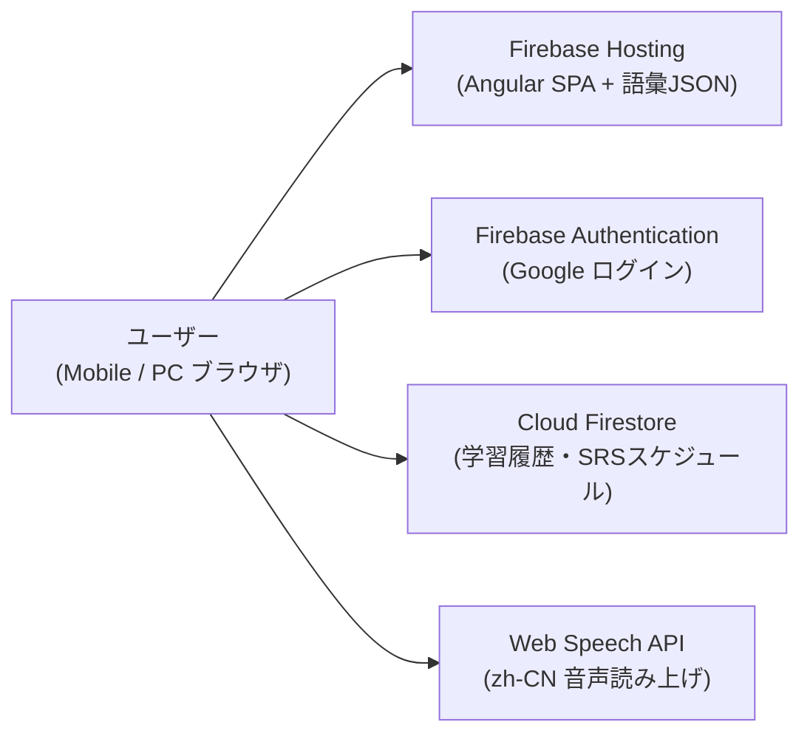
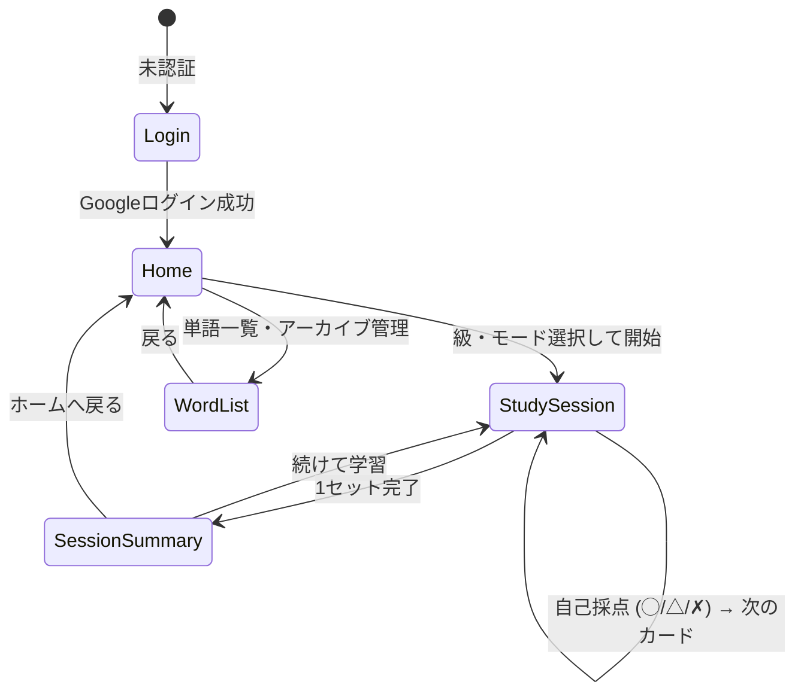

# HSK 語彙特訓フラッシュカードアプリ 仕様書

## 1. プロジェクト概要

### 1.1 背景と解決したい課題
中国語（HSK 1〜6級）の語彙習得において、以下の2つの課題を克服するための**モバイルファースト**なWebフラッシュカードアプリを構築する。

1. **声調の定着不足**: 基本単語であっても声調（四声・軽声）があやふやになりがち。
2. **音声と意味の即時結合不足**: 音を聞いてもすぐに概念（漢字・意味）が思い浮かばない。

### 1.2 対象ユーザー・利用環境
- **利用形態**: Google アカウントでログインし、スマートフォン（メイン）および PC のブラウザから同じ学習データを同期して利用可能。
- **ホスティング**: Firebase Hosting による SPA（Single Page Application）配信。

---

## 2. 技術スタック・システム構成

| 領域 | 採用技術 | 備考 |
| :--- | :--- | :--- |
| フロントエンド | **Angular** (Standalone Components / Signals) | SPA 構成、レスポンシブ対応 |
| UI / デザイン | **Angular Material** (Material Design 3) | マテリアルデザイン準拠、モバイル最適化 |
| ホスティング | **Firebase Hosting** | HTTPS 配信、SPA ルーティングリライト |
| 認証 | **Firebase Authentication** | Google プロバイダによるサインイン |
| データベース | **Cloud Firestore**（Firebase Database） | ユーザー別進捗データのリアルタイム同期・オフラインキャッシュ対応 |
| 音声合成 (TTS) | **Web Speech API** (`SpeechSynthesis`) | ブラウザ標準の `zh-CN` 音声を使用 |
| 語彙マスターデータ | 静的 JSON (`assets/vocabulary/hsk1.json` 〜 `hsk6.json`) | `vocabulary/*.csv` からビルド前処理で生成 |

### 2.1 システム構成図



---

## 3. 語彙マスターデータ仕様

リポジトリ内 `vocabulary/hsk1.csv` 〜 `hsk6.csv` をソースとして使用する。

### 3.1 現状データの解析結果と件数
事前調査により、CSV ファイルには以下の特徴があることが確認されている。

| ファイル | 有効単語数 | データ構造上の注意点 |
| :--- | ---: | :--- |
| `hsk1.csv` | 153 語 | 154行目以降〜999行目まで空行（`,,,,FALSE`）が含まれる |
| `hsk2.csv` | 153 語 | 154行目以降〜999行目まで空行（`,,,,FALSE`）が含まれる |
| `hsk3.csv` | 299 語 | 300行目以降〜999行目まで空行（`,,,,FALSE`）が含まれる |
| `hsk4.csv` | 600 語 | 601行目以降〜999行目まで空行（`,,,,FALSE`）が含まれる |
| `hsk5.csv` | 1,300 語 | ヘッダ＋1,300語 |
| `hsk6.csv` | 2,513 語 | 各行の末尾に余分な空列（末尾カンマ `,`）が含まれる |
| **合計** | **5,018 語** | ヘッダ: `番号,中国語,ピンイン,日本語,FALSE` |

### 3.2 データ変換・クレンジングルール
アプリからの高速ロードおよび Firestore 読み取り課金削減のため、CSV をそのまま配信せずビルド前スクリプトで正規化済み JSON に変換してアプリに同梱する。

1. **空行の除外**: `中国語` 列が空（空白のみ含む）のレコードはスキップする。
2. **余分な列の無視**: 5列目（`FALSE`）および 6列目以降（`hsk6.csv` の末尾空列）は無視する。
3. **前後空白のトリム**: 各フィールドの前後空白を除去する（例: `hsk6.csv` の一部日本語訳にある先頭スペース）。
4. **一意 ID の付与**: `{level}_{number}` 形式ではなく、ゼロ埋めまたはプレフィックス付き ID（例: `hsk1_0001` 〜 `hsk6_2513`）を発番する。

```json
// 生成される JSON 例 (src/assets/vocabulary/hsk1.json)
[
  {
    "id": "hsk1_1",
    "level": 1,
    "number": 1,
    "hanzi": "爱",
    "pinyin": "ài",
    "meaning": "愛する"
  }
]
```

---

## 4. 機能仕様

### 4.1 認証・ユーザー管理
- **Google ログイン**: Firebase Authentication の GoogleAuthProvider を使用。
  - モバイルブラウザでのポップアップブロック対策として、`signInWithPopup` 失敗時のフォールバックまたは環境に応じた `signInWithRedirect` 対応を検討する。
- **未ログイン時**: アプリ紹介と「Google でログインして始める」ボタンのみのシンプルなランディング画面を表示する。
- **ログアウト**: ヘッダメニュー等からサインアウト可能。

### 4.2 ホーム / 学習メニュー画面
- **学習モードの選択**:
  - **① 声調特訓モード**（漢字 → ピンイン・声調）
  - **② 音→概念モード**（ピンイン＋音声 → 漢字・意味）
- **HSK 級の選択（1級〜6級）**:
  - 各級カードに以下の進捗サマリーを表示する：
    - **習得済み（アーカイブ）数 / 総単語数**（プログレスバー）
    - **本日の復習予定数**（忘却曲線により期限到来している単語数バッジ）
    - **学習中 / 未学習数**
- **学習開始アクション**: 級とモードを選んで「特訓スタート」ボタンを押下するとフラッシュカード画面へ遷移する。

### 4.3 ① 声調特訓モード（漢字＋意味 → ピンイン・声調）
1. **問題表示（表面）**:
   - 画面中央のカードに**中国語（漢字表記）**を大きく表示し、その下に**日本語の意味**を表示する（多音字の読みを特定できるようにするため）。
   - カード上部に、現在の状態（`新規` / `復習`）と現在の連続「◯」回数（例: `●●○` 0〜2回）を表示する。
   - ユーザーは頭の中でピンインと声調を思い浮かべる。
2. **解答表示（裏面）**:
   - カード領域（または画面内の回答表示エリア）をタップ/クリックすると解答を展開する。
   - **ピンイン（声調記号付き）**を大きく強調表示し、確認用の**音声再生ボタン**を配置する。
3. **自己採点**:
   - 画面下部に配置された3つのボタンから自己採点を選択して次の単語へ進む：
     - **◯（自信あり）**
     - **△（たまたま当たった）**
     - **✗（外れた）**

### 4.4 ② 音から概念を思い浮かべるモード（ピンイン＋TTS → 漢字・意味）
1. **問題表示（表面）**:
   - 画面中央のカードに**ピンイン**を表示し、同時に **TTS（`zh-CN`）で音声を自動再生**する。
   - 再聴用の「もう一度聞く」ボタン、および再生速度切替（例: `0.8x` / `1.0x`）ボタンを配置する。
   - ※ **モバイルブラウザ制約への対応**: iOS Safari 等ではユーザー操作なしの自動再生が制限されるため、前のカードの「◯ / △ / ✗」ボタン押下時や「スタート」ボタン押下時のクリックイベントハンドラ内で同期的に `speechSynthesis.speak()` を呼び出す設計とする。
   - ユーザーは音とピンインから頭の中で漢字と意味（概念）を思い浮かべる。
2. **解答表示（裏面）**:
   - カード領域（画面）をタップ/クリックすると解答を展開する。
   - **漢字表記**と**日本語の意味**を表示する。
3. **自己採点**:
   - ①と同じく **◯（自信あり） / △（たまたま当たった） / ✗（外れた）** の3択で自己採点し、次の単語へ進む。

### 4.5 アーカイブ・単語一覧画面（補助機能）
- 級ごと・モードごとに、単語のステータス（未学習 / 学習中 / アーカイブ済み）を一覧・検索できる画面を用意する。
- アーカイブ済みの単語を「もう一度学習対象に戻す（リセット）」操作を可能にする。

---

## 5. 学習アルゴリズム仕様（エビングハウスの忘却曲線 & 3回連続アーカイブ）

※ ユーザー要望の「リビングハウスの忘却曲線」は、記憶研究における**エビングハウスの忘却曲線（Ebbinghaus Forgetting Curve）**に基づく間隔反復（SRS: Spaced Repetition System）として実装する。

### 5.1 モード別の独立進捗管理
「漢字を見て声調を言える（モード①）」と「音を聞いて意味がわかる（モード②）」は異なる記憶スキルであるため、**単語ごとにモード①・モード②それぞれ独立して学習履歴・連続◯回数・次回出題日時を管理**する。

### 5.2 ステータス遷移とスコアリングルール

各単語は以下の 3 つのステータスを持つ：
- `new`: 未出題
- `learning`: 学習中（テスト履歴あり、まだ3回連続◯に達していない）
- `archived`: 習得済み（**3回連続で「◯」**を獲得し、通常の出題対象から除外）

| 自己採点 | 連続◯回数 (`streak`) | ステータス | 次回出題タイミング (`nextReviewAt`) |
| :--- | :--- | :--- | :--- |
| **◯（自信あり）** | `streak + 1` | `streak >= 3` なら **`archived`**<br>それ以外は `learning` | `streak = 1`: **+1日（24時間後）**<br>`streak = 2`: **+3日（72時間後）**<br>`streak >= 3`: アーカイブ（次回出題なし） |
| **△（たまたま）** | `0` にリセット | `learning` | **+10分後**（または現セッション後半で再テスト）※ |
| **✗（外れた）** | `0` にリセット | `learning` | **即時リトライキュー**（数問後／セッション末尾で再テスト）※ |

> ※ セッション内再出題について：「△」「✗」を選んだ単語は `nextReviewAt` を直近時刻に設定し、**同じ学習セッションの残りキューの後半に再挿入**することで、その場での短期定着を図りつつ、日時ベースでも忘却曲線に乗せる。（セッション内で再テストして「◯」になればその時点の `streak = 1` として翌日復習へ進む）

### 5.3 出題優先順位（カード抽出ロジック）
1セッションあたり **10〜20問**（ユーザーが設定またはデフォルト15問、あるいはエンドレス継続可）を目安に、以下の優先順位で単語を出題する。

1. **復習期限到来済み（`learning` かつ `nextReviewAt <= 現在時刻`）**:
   - 期限超過が大きいもの（または正答率が低いもの）を優先しつつ、同条件内ではランダム性を少し混ぜる。
2. **新規未学習（`new`）**:
   - 選択中の級から、まだそのモードで一度もテストしていない単語を**ランダム**に抽出する。
3. **復習期限前（`learning` かつ `nextReviewAt > 現在時刻`）**:
   - 上記 1・2 がすべて無くなった場合（全単語を一度学習済みで、かつ復習待ちのみの場合）に、「前倒し復習」として `nextReviewAt` が近い順に出題するか、本日のノルマ完了画面を表示して任意で前倒し学習を選べるようにする。

---

## 6. データベース設計（Cloud Firestore）

### 6.1 コレクション構造

```text
users/
  {uid}/
    profile (またはユーザードキュメント直下フィールド)
      - displayName: string
      - email: string
      - updatedAt: timestamp
      - settings: {
          sessionSize: number (default: 15)
          ttsRate: number (default: 1.0)
        }
    progress/
      {mode}_{wordId}/   (例: "tone_hsk1_1", "audio_hsk1_1")
        - mode: "tone" | "audio"
        - level: number (1..6)
        - wordId: string (例: "hsk1_1")
        - status: "learning" | "archived"
        - streak: number (0..3)
        - totalAttempts: number
        - correctCount: number
        - lastResult: "circle" | "triangle" | "cross"
        - lastTestedAt: timestamp
        - nextReviewAt: timestamp | null
        - archivedAt: timestamp | null
```

- **未学習単語の扱い**: Firestore には**一度でもテストした単語のみ**ドキュメントを作成する（全5,018語×2モード＝10,036件を初期作成しないことで書き込みコストと初期読込量を最小化）。
- **級・モード別の高速集計**: 1〜6級の進捗（学習中数・アーカイブ数）を毎回全件スキャンせずに表示するため、`users/{uid}/stats/{mode}_{level}` にサマリーカウンタ（`learningCount`, `archivedCount`）をトランザクション／バッチで同時更新する設計を推奨する。

### 6.2 セキュリティルール（Firestore Security Rules）
認証済みユーザー本人のデータのみ読み書きを許可する。

```javascript
rules_version = '2';
service cloud.firestore {
  match /databases/{database}/documents {
    match /users/{userId}/{document=**} {
      allow read, write: if request.auth != null && request.auth.uid == userId;
    }
  }
}
```

---

## 7. UI / UX 設計（モバイルファースト）

### 7.1 画面遷移図



### 7.2 モバイル操作性への配慮
- **片手操作レイアウト**:
  - 上部：ヘッダ（戻るボタン、級・モード名、進捗 `3 / 15`）
  - 中央：フラッシュカード本体（タップ領域を大きく確保し、カード内どこをタップしても答えを表示）
  - 下部（親指が自然に届くエリア）：答え表示後に **「✗ 外れた」「△ たまたま」「◯ 自信あり」** の3ボタンを横並びで大きく配置（マテリアルデザインの Elevated / Tonal ボタン、色分け：✗ 赤系 / △ 黄・橙系 / ◯ 緑・青系）。
- **誤操作防止**: 問題表示中（裏返す前）は自己採点ボタンを非表示または非活性にし、必ず一度答えを確認してから採点できるようにする。
- **PC 利用時のショートカット**:
  - `Space` / `Enter`: 答え表示
  - `1` (または `←`): ✗ / `2` (または `↓`): △ / `3` (または `→`): ◯
  - `R`: 音声再再生

### 7.3 デザインシステム（Angular Material）
- Angular 公式の **Angular Material**（Material Design 3）を採用し、エレベーション・リップル効果・タイポグラフィ・カード・プログレスバー等のマテリアルデザインガイドラインに準拠した UI を構築する。

---

## 8. 開発フェーズ案

1. **Phase 1: 基盤構築 & データ準備**
   - Angular プロジェクト初期化（Angular Material 導入）、Firebase（Hosting / Auth / Firestore）接続設定
   - `vocabulary/*.csv` → JSON 変換スクリプト作成と全5,018語のクレンジング検証
   - Google ログイン画面・認証ガード実装
2. **Phase 2: コア学習機能（モード①・②）**
   - ホーム画面（級選択・モード選択）
   - フラッシュカード UI（声調特訓モード / 音→概念モード）
   - Web Speech API (`zh-CN`) TTS 統合（モバイル再生対応）
   - SRS（忘却曲線＋3回連続◯アーカイブ）ロジックと Firestore 永続化
3. **Phase 3: 補助機能 & 仕上げ**
   - セッション完了サマリー画面
   - アーカイブ・単語一覧画面（検索・リセット機能）
   - Firebase Hosting へのデプロイ、実機（iOS/Android モバイルブラウザ）での TTS・UI 動作確認

---

## 9. 確定済み仕様パラメータ

| 項目 | 決定内容 |
| :--- | :--- |
| UI ライブラリ | **Angular Material** |
| 復習間隔（SRS） | 1回目◯: +1日後 / 2回目◯: +3日後 / 3回目◯: アーカイブ |
| 1セットの問題数 | **15問**（完了後に続けて次のセットへ進める） |
| Firebase プロジェクト | 新規作成して接続 |
